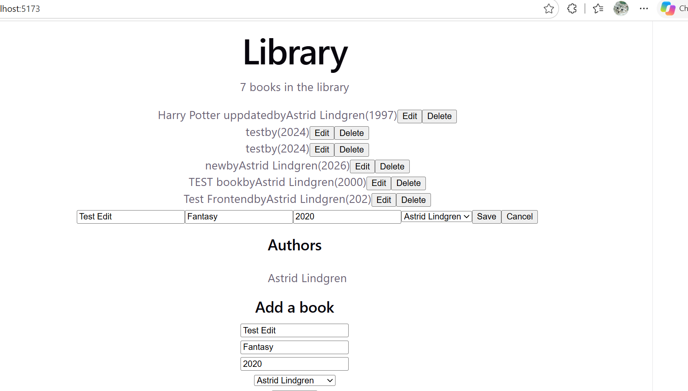

#Week 11 - Sentry

## Exercise 1
### Question 1
Sentry must start first so it can catch errors from the beginning. 
### Question 2
To keep the DSN private and easy to change. 

## Exercise 2
### Question 
Sentry shows the error, when and where it happend, Node.js version,Windows, environment and where in the code the error is. 

## Exercise 3
### Question 
Sentry did not catch the error because the error handler was before the routes.

## Exercise 4
### Question 1
try/catch already catches errors. We need captureException to send them to Sentry. 
### Question 2
Sentry groups similar errors togehter. That makes it easier to find and fix them. 

## Exercise 5
### Question 
Breadcrumb shows what happend before an error. It helps to see which route was used.
Tag helps to find errors from a specific feature, like books.

## Exercise 6
### Question 

# SonarQube - Week 11
## Exercise 1
### Question 1
Docker ps shows running containers. The STATUS column shows if SonarQube is running. The PORTS column shows port 9000. 
### Question 2
Docker makes SonarQube easier to run without installing it on the computer. 

## Exercise 2
### Question 
SonarQube first found 2 issues. I fixed them and the quality gate passed with 0 issues. 

## Exercise 3
### Issue 1
Rule: Promises should not be left unhandle.
File: index.ts line 38.
Problem: The promise was not handled.
Fix: Use await or .catch()
I agree, unhandle errors can be a problem. 
### Issue 2
Rule: Unreachable code.
File: index.ts line 75
Problem: This code can never run. 
Fix: Remove the code.
I agree unnecessary code should be removed. 

I only found 2 issues in my code. 
### Question 
Security: Protects code from security risks.Example, exposed passwords.
Reliability: Help the code work. Example, unhandle errors.
Maintainability: Makes codes easier to understand and fix. Example, unused code.

## Exercise 4
### Question 1
Someone could use my SonarQube token to access or change project data. Password could give access to private data. Sentry DSN could be used to send fake error reports. 
### Question 2
It´s easier to read, manage and update. It helps prevent misstakes. 

## Exercise 5
### Question 
The numbers is the same 329 lines and 0 issues. We should only scan our own code to avoid unnecessary errors. 

## Exercise 6
### Question 1
To make sure the code still works after each change. 
### Question 2
Yes, I removed unnecessary code.

# Week 13 - React Frontend
## Exercise 1
### Question 1
Frontend and backend use different packages. React is needed in the frontend, not for backend. 
### Question 2
Vite starts the frontend. The brownser updates automatically when I save. 

## Exercise 2
### Step 7
The list of books is in response data.
The total is response.data.length.
The author´s name is in Author.name. 
### Question 1
Cors decide which websites can use the API. Brownser blocked the request beacuse it was not allowed. Postman does not has this rule. 
### Question 2
Fos better sequrity. When the website goes online we change to a new website adress. 

## Exercise 3
### Question 1
React uses a key to know which book is which. The ID is better because it does not change when a book is deleted but the index can change.
### Question 2
useState stores the books and authors. 
useEffect fetches the data when the page opens. Without [] it can fetch the data over and over again.

## Exercise 4
### Question 1
event.preventDefault() stops the page from reloading. Without it the page reloads when we submit the form.
### Question 2
Id is uniue but names can be the same. The user could enter an ID that does not exist.
### Question 3
They can have different rules. We can use a shared schema. 

## Exercise 5
### Question 1
Filter checks each book and keeps all books excpect the one with the selected ID. 
We create a new array so React can update the state. 
### Question 2
The book was deleted even though it had a loan. API allowed it. The user should see an error message. 

## Exercise 6

### Question 1
Put update the whole book.
Patch update just selected fields.
If genre is missing Put returns 400.
With Patch genre stays unchanged.
### Question 2

